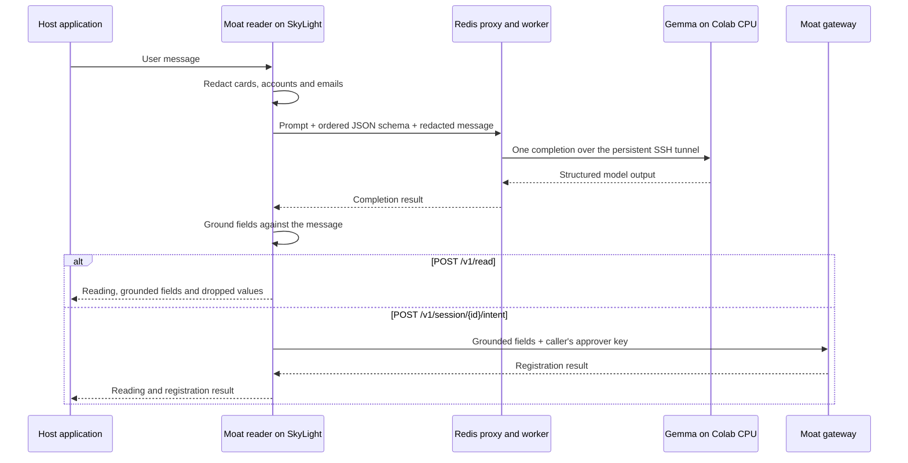

# Moat intent reader: Colab serving architecture

This document describes the deployed setup as of 27 September 2026. SkyLight
runs the Moat reader, gateway and Redis queue. A Colab CPU runtime runs Gemma.
GitHub holds the source, configuration and research artifacts; inference
executes in the Colab runtime.

## Request flow



The SSH connection is kept open. Each request travels through its local port
forward; the system does not start a new SSH login or reload the model for
each message. A single queue worker and a single model slot serialize reads.
Intent registration records what the user requested. Payment execution and
authorization remain the gateway's responsibility.

## Components and interfaces

All addresses below are loopback addresses on SkyLight.

| Component | Address | Role |
| --- | --- | --- |
| Moat intent reader | `127.0.0.1:7083` | Accepts user text, redacts it, requests inference and grounds the answer |
| Completion queue API | `127.0.0.1:8093` | Accepts OpenAI-compatible completion requests and waits for Redis results |
| SSH local forward | `127.0.0.1:8092` | Reaches Colab's loopback `llama-server` |
| Gateway intent API | `127.0.0.1:7082` | Registers grounded intent under the caller's approver key |

### Read without registration

`POST /v1/read` accepts `{"text":"..."}`. It returns `status`, `fields`,
`dropped`, the redacted `record`, and `cards_removed`. This route does not
register an intent or execute a payment. The host can show the extracted
fields to the user before submitting confirmed fields to the gateway.

```sh
curl -sS http://127.0.0.1:7083/v1/read \
  -H 'Content-Type: application/json' \
  -d '{"text":"Pay Orbit Labs Srl 480 USD for invoice INV-100"}'
```

### Read and register

`POST /v1/session/{id}/intent` accepts the same body and the caller's
`Authorization` header. The reader forwards the grounded fields and redacted
record to the gateway, which validates the approver key and its tenant.
The response includes the reading and the gateway's registration result.
The approver key stays on SkyLight; it is not included in the model request,
Redis payload or Colab connection.

Messages must be nonempty and at most 4,000 characters after trimming.

## Model and generation settings

| Setting | Deployed value |
| --- | --- |
| Runtime | Colab CPU Standard |
| Model repository | `unsloth/gemma-4-E4B-it-qat-GGUF` |
| Model file | `gemma-4-E4B-it-qat-UD-Q4_K_XL.gguf` |
| MTP draft file | `mtp-gemma-4-E4B-it.gguf` |
| llama.cpp release | `b11205`, Ubuntu x64 CPU build |
| Model slots | `1` |
| Context | `2048` tokens |
| Speculative decoding | `draft-mtp`, up to four draft tokens |
| Request settings | Temperature `0`, maximum `400` output tokens, thinking disabled |
| Output constraint | JSON schema |

The bootstrap runs this configuration inside Colab:

```sh
llama-server \
  -m /content/models/gemma-4-E4B-it-qat-UD-Q4_K_XL.gguf \
  -md /content/models/mtp-gemma-4-E4B-it.gguf \
  --host 127.0.0.1 --port 8092 \
  --jinja --no-mmproj -ngl 0 -ngld 0 \
  -t <available-cpu-threads> -td <available-cpu-threads> -np 1 -c 2048 \
  --spec-type draft-mtp --spec-draft-n-max 4
```

The MTP model proposes tokens that the main model verifies. How many it
should propose depends on the hardware, and the answer differs:

| Draft tokens | CPU, six cores (median s) | T4 GPU, warm (median s) | Correct of 36 |
| --- | --- | --- | --- |
| 2 | 5.11 | about 0.9 | 36 |
| 4 | **3.72** | about 0.83 | 36 |
| 6 | 4.15 | about 0.83 | 36 |
| 8 | 4.11 | **about 0.63** | 36 |

On CPU four is fastest and the bootstrap uses four. On a T4, eight is about
a quarter faster than four with every message still read correctly, so a GPU
runtime should be started with `--spec-draft-n-max 8` and `-ngl 99`. The GPU
column is Zahra's measurement (`zahra_speed.csv`, 30 September 2026); her
runs also found that Q5_K_M and Q8_0 each read 5 of the 36 messages wrong
where the QAT Q4 model read all 36, so the larger files are not an upgrade.

The bootstrap pins the llama.cpp release;
the Hugging Face downloads currently specify filenames without a repository
revision, so rebuilding a runtime is not a fully immutable model snapshot.

## Structured output and grounding

The schema emits fields in this order:

1. `pay`: names the user asks to pay now.
2. `refused`: names the user rejects or cancels.
3. `amount`: amount as written, or null.
4. `currency`: ISO currency code, or null.
5. `destinations`: account placeholders selected from the message.
6. `references`: invoice, order or ticket identifiers.
7. `cancels_previous`: whether the user withdraws an earlier request as a whole.

The reader sends the schema as `serde_json::value::RawValue` inside typed
request structs, preserving this property order on the wire. The prompt and
ordered schema are hashed together. Each reading's `reader` field records
the reader version, model name and prompt/schema hash for traceability.

Before inference, the redactor removes detected card numbers from both the
model input and retained record. It replaces recognized account destinations
and email addresses with placeholders in the model input. The placeholder
map stays in the reader process and restores selected accounts afterwards.

Grounding applies these checks:

- A requested payee must occur literally in the redacted message. Names
  covered by a refusal are removed from `pay`.
- Amounts are normalized with locale-aware number handling and must match a
  number present in the message. Ambiguous supported number forms are dropped.
- Currency values must be codes accepted by the core.
- An account destination must resolve through the redactor's placeholder map.
  Email placeholders and arbitrary literal text cannot supply an account.
- References must occur in the message and must not be placeholders.
- With neither a requested payee nor a selected account, amounts are removed.

The response lists discarded values and their reasons in `dropped`.
Grounding checks copied values; semantic judgments such as which named party
is being requested, refusal scope and cancellation still depend on the model.

## Queue behavior and interruptions

The proxy assigns each request a job ID and stores its redacted completion
payload under `moat:colab:payload:<id>`. It pushes the ID onto
`moat:colab:pending`. The worker atomically moves the oldest ID to
`moat:colab:processing`, performs one completion, then commits the result and
removes the processing entry in a Redis transaction.

The HTTP request stays open while waiting for its result. This is a synchronous
API backed by a queue, rather than a client-facing submit-and-poll job API.

| Queue control | Value |
| --- | --- |
| Concurrent waiting HTTP requests | Up to 3 |
| Pending + processing admission threshold | 3 jobs |
| Per-job deadline and HTTP result wait | 120 seconds |
| Model HTTP timeout | At most 115 seconds, bounded by remaining job time |
| Payload expiry | 3,600 seconds; deleted on completion |
| Unconsumed result expiry | 120 seconds |

A worker restart can repeat an unfinished inference from the processing list.
Inference has no payment side effect. Expired jobs and model connection errors
return an unavailable result; jobs are not held indefinitely for Colab to return.
Redis uses AOF persistence, but expiring a key does not erase it from existing
persistence files or backups. Redaction does not remove all message content.

If the model or queue cannot provide an answer, Moat returns
`status: "unavailable"` with empty intent fields. The registration route
forwards those empty fields. Consumers must inspect `status`, since a read
response can use HTTP 200 even when inference is unavailable. The host retries
after service recovery instead of treating the failed read as authorization.

## Service operation

| systemd unit | Responsibility |
| --- | --- |
| `moat-colab-tunnel.service` | Copies the bootstrap to Colab and maintains the SSH forward |
| `moat-colab-queue-api.service` | Runs the loopback completion API |
| `moat-colab-queue-worker.service` | Runs the single Redis consumer |
| `moat-intent.service` | Runs the grounded reader connected to the queue and gateway |

The Colab bootstrap checks model health every 15 seconds and attempts to start
the model when unavailable. The tunnel unit restarts after a lost connection
and can request a CPU runtime through `google-colab-cli`. The `ProxyCommand` in
`/var/lib/moat/.ssh/config` omits `--gpu`, so replacement runtimes use CPU.
CLI credentials and SSH keys belong to the `moat` service user. Colab capacity, runtime expiry and
authorization can interrupt service; automatic recovery is attempted and
does not guarantee continuous availability.

The Redis ACL user is restricted to `moat:colab:*`. Its credentials are loaded
from `/etc/moat/colab-queue.env`, outside Git. The queue and reader bind to
loopback; a trusted host application supplies the client-facing integration.

```sh
systemctl is-active moat-intent moat-colab-queue-api \
  moat-colab-queue-worker moat-colab-tunnel
curl -sS http://127.0.0.1:8093/health
curl -sS http://127.0.0.1:8092/health
```

The queue health response reports `pending` and `processing` counts. Its
health endpoint does not itself test inference. An actual `/v1/read` request
checks the complete serving path.

## Previous T4 deployed measurement

The [saved live run](colab-live-results.json), recorded on 27 September 2026
at commit `e7e8831`, sent 54 synthetic messages through the deployed
`/v1/read` endpoint: the 36-message multilingual corpus plus 18 additional
validation messages. Requests ran sequentially and did not register intents
or execute payments.

| Metric | T4 run |
| --- | ---: |
| Completely correct readings | 52/54 |
| Payees, refused names, amounts, currencies, cancellation and destinations | 54/54 each |
| Exact reference sets | 52/54 |
| Cases containing an unasked payee | 0 |
| Median response time | 1.475 seconds |
| p95 response time | 1.610 seconds |

The two remaining errors included `flat deposit` and `office deposit` as
references. These descriptions occur in the input, so substring grounding
does not distinguish them from identifiers.

A complete reading requires exact name and reference sets, the expected
canonical amount, an accepted currency for an active payment, the correct
cancellation flag and no spurious destination. Amounts must be absent when
there is no payment. The timing includes the reader, queue, SSH-forwarded
model call and grounding; it is not GPU generation time alone. This small
internal corpus does not measure production accuracy or outage recovery.

## CPU baseline check without MTP

On 27 September 2026, Colab allocated a CPU Standard runtime with two CPUs
and 12 GiB RAM. The first direct completion with the full reader prompt and
schema took 81.16 seconds while the prompt cache was cold. With that runtime
warm, a complete `/v1/read` payment request took 37.80 seconds and returned
the payee, amount, currency and invoice reference. A refusal plus cancellation
request took 29.75 seconds and returned no payee, the refused name and the
cancellation flag. These are two synthetic smoke cases, not a CPU corpus or
capacity benchmark. The 120-second queue deadline covers the measured cold
start while preserving fail-closed behavior when the model cannot answer.

## CPU MTP comparison

On the same two-core Colab runtime, four corpus cases were sent directly to
separate CPU `llama-server` processes with identical prompts and JSON schemas.
Each process was warmed first. The MTP process used four draft tokens ahead.

| Case | Without MTP | With MTP | Raw answers equal |
| --- | ---: | ---: | --- |
| English payment | 38.68 s | 32.22 s | Yes |
| Arabic payee switch | 41.82 s | 35.29 s | Yes |
| Quoted injected payee | 39.18 s | 32.21 s | Yes |
| Chinese cancellation | 29.90 s | 25.91 s | Yes |
| Median | 38.93 s | 32.22 s | 4/4 |

The [raw paired results](colab-cpu-mtp-results.json) include timings, draft
acceptance and answers. This is a small direct-model comparison, not a full
reader corpus evaluation or a guarantee that every request will be faster.
After the production Colab model switched to MTP, a cold `/v1/read` request
with a quoted injected payee returned the authorized payee and refused the
injected name in 93.01 seconds. A warm payment read returned the grounded
payee, amount, currency and invoice reference in 31.44 seconds. Both passed
through the reader, Redis worker and SSH tunnel; neither registered an intent
or executed a payment.

To repeat the measurement from the repository on SkyLight:

```sh
python3.12 research/intent-reader/evaluate_live.py \
  --url http://127.0.0.1:7083 --output /home/moat-eval/live-results.json
```

## Implementation map

| Source | Purpose |
| --- | --- |
| [`reader.rs`](../../crates/moat-intent/src/reader.rs) | Prompt, request serialization, provenance label and unavailable readings |
| [`intent.schema.json`](../../crates/moat-intent/src/intent.schema.json) | Ordered output schema |
| [`redact.rs`](../../crates/moat-intent/src/redact.rs) | Input redaction and placeholder mapping |
| [`ground.rs`](../../crates/moat-intent/src/ground.rs) | Validation and restoration of model fields |
| [`server.rs`](../../crates/moat-intent/src/server.rs) | Read and registration HTTP routes |
| [`moat-colab-queue.py`](../../scripts/moat-colab-queue.py) | Redis proxy and worker |
| [`colab-gemma-server.py`](../../scripts/colab-gemma-server.py) | Colab model bootstrap and health loop |
| [`deploy/`](../../deploy/) | systemd unit definitions |
| [`evaluate_live.py`](evaluate_live.py) | Full-path evaluation and scoring |
